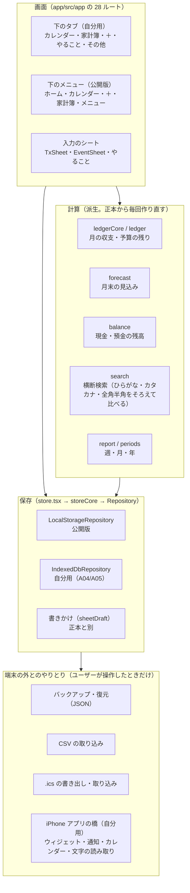
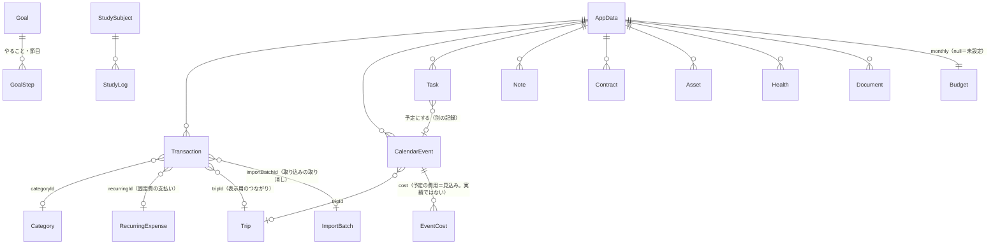
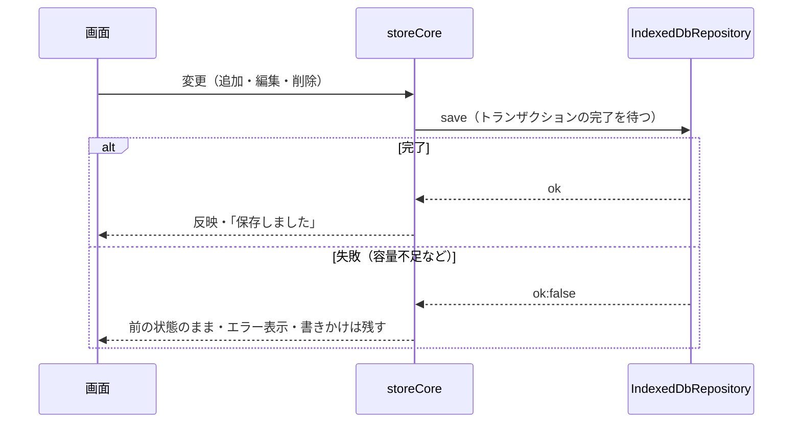

# くらしベースの構成とデータの形（o29 時点、2026-11-27）

正本は `app/src/lib/types.ts` の `AppData`（形式の番号 2）。この文書は全体の見取り図で、細かい決まりはコードと試験が正本。

## 1. 全体の構成

- 版の分け方：`lib/edition.ts` の `FEATURE_EDITIONS` と `IS_PERSONAL`。組み立てるときに決まり、公開版のビルドには自分用だけの部品が入らない。
- 予算の対象：公開版はすべての支出、自分用は投資を除く（`BUDGET_EXCLUDES_INVEST`）。計算は共通で、版の差は引数で渡す（o29 C015）。
- Swift（iPhone アプリ）は写しだけを持ち、記録の正本は画面の中の保存だけ（A07。`docs/integration/A07_NATIVE_BOUNDARY.md`）。

## 2. データの形（AppData）と関係

- 実績は `Transaction` だけ。予定の費用（`CalendarEvent.cost`）は見込みで、実績には数えない（o29 C008）。
- カードの購入と引き落とし：費用は購入の1回だけ。引き落としは現金の動きで、収支に数えない（X03・C009）。
- 返金：購入月の純額と、返金日の現金の戻りを分ける（`lib/refund.ts`・C010）。
- 旅行を削除しても、支出は残してつながりだけ外す（`unlinkTripFromTx`・C012）。
- 書き換えは足すだけ。任意の項目は消さない。形式を変えるときは `migrate()` と試験が先（PJ_RULES）。
- o29 の Account・Posting・Allocation（配分）・操作ID は、今のデータには無い。足すかは ADR と移行試験が先で、今回は作っていない（o29 C016・C011）。

## 3. 保存の流れ（自分用）

移行（localStorage → IndexedDB）：読む → 検査 → 仮置き → 件数・金額・関連 ID を読み直して比べる → 一致したときだけ切り替える。旧データは消さない（`lib/idbRepository.ts`）。

## 4. 画面の入口（自分用、o29 A 案）

| タブ | 入る画面 | ＋の既定 |
|---|---|---|
| カレンダー | /calendar | 予定（選んでいる日） |
| 家計簿 | /report・/history・/recurring・/decide・/inbox・/assets・/nisa | 支出 |
| やること | /tasks | やること |
| その他 | /menu と、それ以外の全部（ホーム / を含む） | 種類を選ぶ |

起動時の画面は設定で選ぶ（初期はカレンダー。`lib/startScreen.ts`）。
