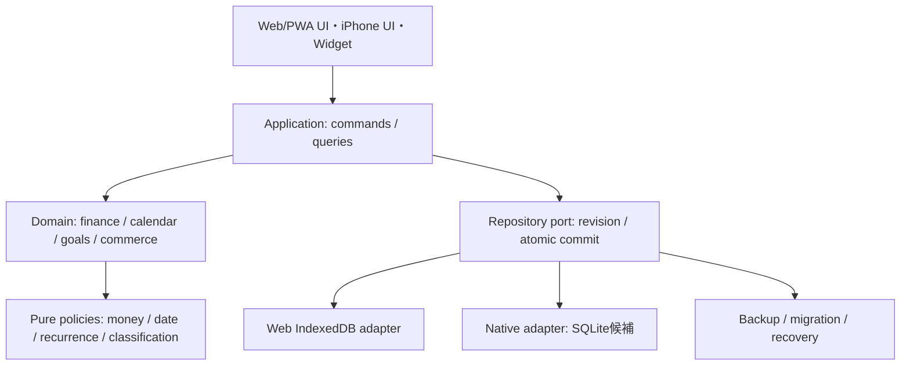

# o9 アーキテクチャ刷新計画（100点の受入条件）
基準 o8。現行は app/src/app・components → store.tsx / lib 計算 → AppData/schema → storage.ts → localStorage 本体と取消全体コピー。計算は画面からも直接呼ぶ。ネイティブ実装は受領ZIPにない。既存仕様・Phase0–6・公開承認を維持する。

## To-Be

依存はUI→application→domain、application→port、adapter→port。domainはReact・DOM・storage・networkに依存しない。現行libの純粋関数は再利用し、ファイル移動だけのリファクタはしない。ネイティブは現物確認後に決定し、WebViewとSQLiteの二重正本は禁止。ウィジェットは読取専用の版付き派生スナップショット。外部リンクは明示操作のみ、収益判定は会計に影響させない。

## 台帳設計（未実装）
取引ID、発生日、記録時刻、金額（JPY整数・安全整数範囲）、分類、口座ID、カードID、関連元IDを明示。購入・返金・振替・カード決済を別イベントにし、訂正は元イベントを保存して取消/訂正を追加。現金残高基準とカード債務基準は別。カードごとの開始債務・請求・決済割当を管理し、欠落は不明と表示。購入月実績、返金月キャッシュフロー、購入純負担を別クエリにする。既存返金の原額復元は検証可能な記録のみ、曖昧な場合は原本保持・要確認。分類変更による過去集計変更の意味を明示。全画面で期間・基準日・版ポリシーを明示する。

## 保存設計（未実装）
IndexedDBで revision の照合と更新・取消差分を同一readwrite transaction内に行う。commit完了後のみUI成功。失敗時は入力を保持。初期は単一snapshotでも原子的に保存し、測定後にcollection分割。移行は旧データ読取→検証→新DB staging→再読取・件数/金額/関連ID比較→切替。旧データは勝手に消さない。移行途中クラッシュ、複数タブ、容量不足、旧版再起動、復元、消去、バックアップの全経路を検証。永続化要求は保証ではない。origin変更は明示バックアップ復元。新旧の同時書込みは禁止。

## 実装順序と受入ゲート
| ID | 作業 | 合格条件 |
|---|---|---|
| A01 | 現行依存・全書込経路棚卸し | 全route/store/bridge/backupの責任表、循環依存なし |
| A02 | 取引モデルと移行仕様 | 旧v1/v2、返金・部分払い・カード・NISA・欠落のgolden fixture |
| A03 | 共通台帳・クエリ | 購入/返金/決済の保存則、カード別、日付境界、順序独立 |
| A04 | RepositoryとIndexedDB | 同時更新で消失なし、原子的commit、失敗注入 |
| A05 | 移行と復元 | 再実行可能、原本保持、件数・金額一致、クラッシュ回復 |
| A06 | UI接続 | 全画面で同一条件の金額一致、予測と実績分離 |
| A07 | Native境界 | 実Swift確認、保存正本一つ、通知/OCR/widget回帰 |
| A08 | 性能・安全 | 1/5/10/30年合成データ、容量・応答時間を実機測定、外部送信なし |
| A09 | 全体検証 | 両editionのtypecheck/lint/vitest/build、実機E2E、重大欠陥ゼロ |
| A10 | リリース | 最新SHAでGO、復旧手順実演、WBS同期、承認 |
A01–A10は未完了。100点は設計評価でなく全ゲート証跡で判定。既存Phase/WBSへ重複排除して登録する。商用化は別トラック。新規依存・公開・実データ変更は承認前にしない。

## 今回の互換修正
- balance: 現金基準日と全記録期間のカード差額を分離。カード別・開始債務は未対応、画面に限界を明示。
- allowance/forecast: 固定費の発生日列挙を共通化し、将来の週次支払いを各日へ配置。月末当日の未払は既存表示契約を維持。
- ledger: 過去・未来月の自由残額・日割りを非表示にする（null）。
- schema変更なし。独立回帰は app/tests/standalone/architecture-regression.cjs。全体checkは依存未導入でtypecheck停止。実機・WBS同期未実施。
